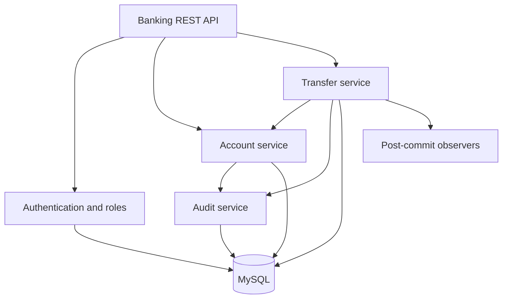

# BankCore

BankCore is a simulated banking REST API built to practice object-oriented design and concurrent database transactions. All amounts are integer minor units. The demo uses a single currency and local bearer tokens.

## Run

From the project directory:

```sh
docker compose up --build -d
curl -fsS http://localhost:8080/health
python3 smoke.py
```

Wait for the health endpoint to respond before running the smoke test. It creates sample accounts and checks authorization, duplicate requests, competing transfers, reverse transfers, history and rollback after a failed credit.

| Endpoint | Purpose |
| --- | --- |
| `POST /accounts` | Create an account using `{"kind":"SAVINGS"}` or `{"kind":"CURRENT"}` |
| `GET /accounts/{id}` | View an owned account |
| `POST /accounts/{id}/deposits` | Credit an owned account using `{"amount":1000}` |
| `POST /accounts/{id}/withdrawals` | Debit an owned account |
| `POST /transfers` | Move funds using `{"sourceId":1,"targetId":2,"amount":100}` |
| `GET /accounts/{id}/history` | Read an owned account's latest 100 movements |
| `GET /audit` | Read the latest 100 audit records as an auditor |

Send `Authorization: Bearer demo-alice-local` or `demo-bob-local` for customer routes and `demo-auditor-local` for audit. Send a fresh `Idempotency-Key` for each new deposit, withdrawal or transfer. An identical committed retry returns the original movement with HTTP 200. Reusing that key for a changed operation returns HTTP 409. Rejected operations roll back their key reservation and can be attempted again. Tokens are set when the demo database is seeded.

## Architecture



A transfer reserves its request key, locks account rows in ascending ID order with `SELECT ... FOR UPDATE`, checks ownership and available funds, writes the balance changes, and inserts a movement and an audit entry. The database commits those writes together. Two API threads or two API processes share the same InnoDB locking rules. A concurrent retry waits on the same request key and reads the committed movement. An aborted transfer leaves its balances, audit trail and request key unchanged.

Savings accounts retain a 100-unit reserve after debits. Current accounts charge 25 units on outgoing transfers. The debit includes the fee and the ledger stores the fee separately. The database service user can append ledger and audit entries. It lacks update, delete and drop privileges on those records, and triggers reject row edits and deletes. The auditor can read the trail through the API. A post-commit observer logs movement notifications. It is best-effort and can be missed if the process stops immediately after committing.

## OOP walkthrough

| Concept | Implementation |
| --- | --- |
| Encapsulation | `Account` keeps its balance private. `credit` and `debit` control mutations. |
| Abstraction | Abstract `Account` exposes shared behavior. `MoneyCommand` defines the required data for monetary operations. |
| Inheritance | `SavingsAccount` and `CurrentAccount` extend `Account`. |
| Runtime polymorphism | `debit` calls `minimumRemainingBalance`. The account subtype decides how much must remain. |
| Composition and Strategy | An account holds a `FeePolicy`. The factory configures fees independently of the balance logic. |
| Factory | `AccountFactory` builds the correct subtype when restoring an account from MySQL. |
| Observer | `MovementObserver` receives a committed movement. Replays skip notification. |
| Exceptions | `BankError` carries an application error to the HTTP boundary. The database helper rolls back failed transactions. |
| Multithreading | An executor handles concurrent HTTP requests. Transactions and row locks protect balance changes across processes. |
| SOLID | Account rules, transfer coordination, authentication and auditing have separate responsibilities. Services use small fee, command and observer contracts. |

## Interview practice

1. **What if two clients each withdraw 600 from an account with 1,000?** One locks the account first. The second checks the committed balance after acquiring the lock and fails.
2. **Why lock in ascending account ID order?** Opposite transfers acquire locks in the same order. This avoids the circular wait that occurs if each transfer locks its source first.
3. **What if the client times out after commit?** Repeating the same request key returns the original movement. Reusing the key with a different amount returns a conflict.
4. **What if crediting the destination fails after debiting the source?** Both changes share a transaction. An exception rolls back the debit and any other writes from that transfer.
5. **Which part is polymorphic?** The base class calls an overridden debit rule through the account subtype at runtime. The fee strategy is a separate object, so changing a fee does not require changing the debit algorithm.
